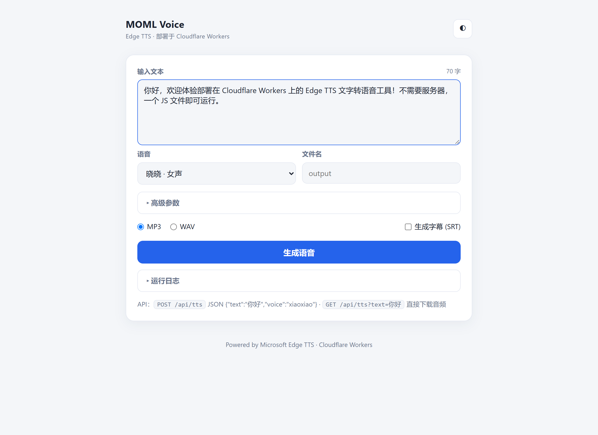
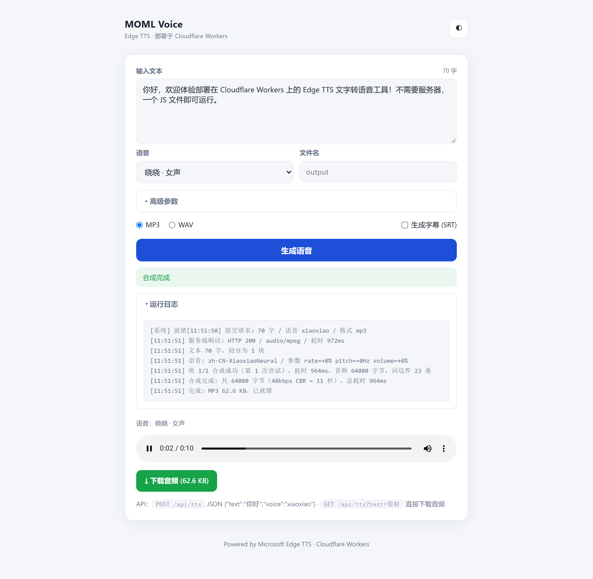
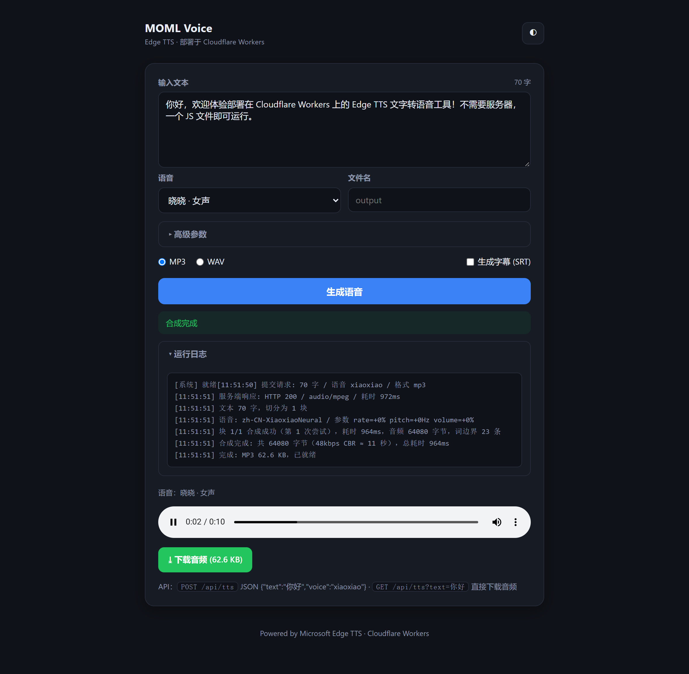

# Edge TTS Web Interface — Cloudflare Workers 版

**一句话**：原 Python/Flask 项目的 Cloudflare Workers 移植版——用 JS 直接实现微软 Edge TTS 的
WebSocket 合成协议，**单个 `worker.js` 文件即可部署**，无需 Python、无需 ffmpeg、无需任何服务器，免费版 Workers 就能跑。

> 📌 **项目来源**：本项目重构改版自 [shuo0261/edge-tts-web-interface](https://github.com/shuo0261/edge-tts-web-interface)（Python/Flask 版）。
> 感谢原项目的设计思路与功能实现；本版将其核心合成链路重写为 Cloudflare Workers JS 实现，并重构了界面与部署方式。

  

---

## ✨ 界面预览

**主界面（浅色）**——输入文本、选音色、高级参数折叠收起：



**生成完成**——在线播放、下载音频，底部"运行日志"实时输出每一步（文本分块、服务端响应、
每块合成耗时、音频字节数、词边界条数）：



**深色模式**（右上角一键切换，自动跟随系统）：



## 🔊 实测产物

以下文件均由本项目**真实运行生成**（2026-10-07，workerd 运行时实测），可直接点击试听/下载：

| 产物 | 场景 | 说明 |
|---|---|---|
| [zh-xiaoxiao-demo.mp3](docs/samples/zh-xiaoxiao-demo.mp3) | 短文本 · 晓晓（普通话） | 70 字，1.0 秒合成，46 KB |
| [zh-yunxi-params.mp3](docs/samples/zh-yunxi-params.mp3) | 参数调节 · 云希 | 语速 +20% / 音调 -5Hz / 音量 +30% |
| [en-ava-long-text.mp3](docs/samples/en-ava-long-text.mp3) | 英文长文本 · Ava | 5 句英文，157 KB |
| [en-ava-long-text.srt](docs/samples/en-ava-long-text.srt) | 上面音频的**真字幕** | 由微软 WordBoundary 时间戳生成（非估算） |
| [zh-xiaoxiao-1500zi.mp3](docs/samples/zh-xiaoxiao-1500zi.mp3) | 长文本分块 · 晓晓 | 约 1500 字自动切 2 块合成，4.6 秒，2.1 MB |

字幕文件内容示例（真实时间轴）：

```srt
1
00:00:00,100 --> 00:00:02,863
Artificial intelligence is transforming the way

2
00:00:02,875 --> 00:00:06,375
we build software Cloudflare Workers lets developers
```

## 🆚 与原版（Python/Flask）的差异

| 功能 | 原版 | Workers 版 |
|---|---|---|
| 文字转语音（MP3） | ✅ edge-tts 子进程 | ✅ JS 重写 WebSocket 协议 |
| WAV 导出 | ✅ ffmpeg 转码 | ✅ 浏览器 Web Audio 本地解码（无 ffmpeg） |
| 语速 / 音调 / 音量 | ✅ | ✅ |
| SRT 字幕 | 每行固定 2 秒（估算） | ✅ **真时间戳**（WordBoundary） |
| 运行日志 | 后端 logging 输出 | ✅ 前端实时日志面板（分块/耗时/重试全可见） |
| 音频存储 | 落盘 tts/ 目录 | 音频直接流式返回，前端 Blob 播放/下载 |
| 语音转文字 STT（Vosk） | ✅ | ❌ 裁剪（44MB 模型放不进 Workers） |

内置音色 18 个：普通话 6 / 辽宁·陕西 2 / 粤语 3 / 台湾腔 3 / 英语 2 / 日语 1 / 西语 1。
> 微软会定期下线音色（原版的 Amy、Luna 已下线，本版已替换为 Ava、Andrew、Elvira）。

## 🚀 快速部署

### 方式 A：Dashboard 在线粘贴（最快，零工具）

1. 打开 [dash.cloudflare.com](https://dash.cloudflare.com) → **Workers & Pages** → **Create** → **Create Worker**
2. 点 **Edit code**，全选删除编辑器内容
3. 粘贴 [`worker.js`](worker.js) 的全部内容 → **Deploy**
4. 访问 `https://<你的子域>.workers.dev` 即可使用

> 从旧版升级：同样进入编辑器，粘贴覆盖 → Deploy，页面 Ctrl+F5 强刷。

### 方式 B：Wrangler CLI

```sh
npm install -g wrangler
wrangler login
cd cloudflare-worker
wrangler deploy
```

## 📖 使用

### 网页
输入文字 → 选音色 → 生成 → 在线播放 / 下载 MP3 / （可选）下载 SRT 字幕 / 导出 WAV。
底部"运行日志"可展开查看全过程。

### API

**① 直接拿音频（网页内部走的就是这个）**

```sh
curl -X POST "https://<worker域名>/api/tts?raw=1" \
  -H "Content-Type: application/json" \
  -d '{"text":"你好，世界","voice":"xiaoxiao"}' \
  --output hello.mp3
```

**② 带字幕（返回 JSON：音频 base64 + SRT + 运行日志）**

```sh
curl -X POST "https://<worker域名>/api/tts?raw=1" \
  -H "Content-Type: application/json" \
  -d '{"text":"你好","subtitles":"1"}'
```

**③ 兼容原版 /api/tts 的 JSON 返回**

```sh
curl -X POST "https://<worker域名>/api/tts" \
  -H "Content-Type: application/json" \
  -d '{"text":"你好","voice":"xiaoxiao"}'
# {"result":"success","file_url":"https://...","format":"mp3","size":64080,"console":"..."}
```

**④ GET 快捷合成（浏览器打开即下载）**

```
GET /api/tts?text=你好&voice=xiaoxiao
GET /api/voices          # 音色列表
```

参数：`text`（必需）、`voice`（音色 id 或完整名如 `zh-CN-XiaoxiaoNeural`）、
`rate`（如 `+20%`）、`pitch`（如 `-5Hz`）、`volume`（如 `+30%`）、`format`（仅 `mp3`）、
`file_name`、`subtitles`（`1` 开启）。已开启 CORS，可跨域调用。

## 🛠 本地验证

不部署也能验证。仓库自带两套脚本：

```sh
# 1) 协议层测试：4 个用例（短文本/参数/英文+字幕/长文分块），真实连接微软服务器
NODE_PATH=<node_modules> node test-local.mjs

# 2) 完整运行时测试 + 截图：wrangler dev（workerd，与线上同环境）
wrangler dev --port 8787
node tools/screenshot.cjs    # 生成 docs/images/ 三张截图
```

## ⚙️ 技术实现要点（维护必读）

- **Sec-MS-GEC token**：`SHA256(Windows file time 取整 5 分钟窗口 + TrustedClientToken)`，
  大写十六进制；403 时自动读服务器 `Date` 头校正时钟偏差并重试（与 python edge-tts 一致）。
- **版本号**：`CHROMIUM_FULL_VERSION = "143.0.3650.75"`。若某天微软更新校验导致 403，
  优先把它更新为最新 Edge 版本号（参考 [rany2/edge-tts](https://github.com/rany2/edge-tts) 的 constants.py）。
- **握手头**：必须带 `Origin: chrome-extension://jdiccldimpdaibmpdkjnbmckianbfold`、
  Edge UA、`Cookie: muid=<随机32位hex>;`。Workers 里用 `fetch + Upgrade: websocket` 出站
  （可带任意头），且**必须先注册事件监听器再 `accept()`**，否则 open 事件会错过导致请求挂起。
- **长文本**：按句切分为 ≤1200 字的块，逐块合成；MP3 为 48kbps CBR，按字节数
  （6000 字节/秒）精确补偿跨块字幕时间轴。
- **输出格式**：Edge 免费接口仅提供 `audio-24khz-48kbitrate-mono-mp3`（PCM/riff 会被
  服务端 1007 拒绝），WAV 由前端 `decodeAudioData` 解码生成。
- **字幕**：`audio.metadata` 以 **TEXT 帧**到达（不是二进制帧），JSON 结构为
  `{Metadata:[{Type,Data:{Offset,Duration,text:{Text}}}]}`，注意扁平化。

## ❓ 常见问题

| 症状 | 原因 | 处理 |
|---|---|---|
| 403 握手失败 | 版本号过旧 / 时钟偏差 | 更新 `CHROMIUM_FULL_VERSION`；已内置时钟自动校正 |
| 偶发"服务端未返回音频数据" | 微软对高频请求的间歇性风控 | 已自动重试 3 次，稍后再试即可 |
| 卡在"正在连接…" | 旧版 accept 时序 bug | 更新到最新 worker.js（2026-10-07 之后） |
| 某音色报错 | 微软下线了该音色 | 换其他音色；可用 `/api/voices` 查询 |

## 💰 免费额度

- Workers 免费版：**每天 10 万次请求**；单请求 CPU 10ms（WebSocket 等待时间不计 CPU）
- 单次合成约 1~5 秒（视文本长度），无并发连接数限制

## License

MIT（同原项目 [shuo0261/edge-tts-web-interface](https://github.com/shuo0261/edge-tts-web-interface)）
